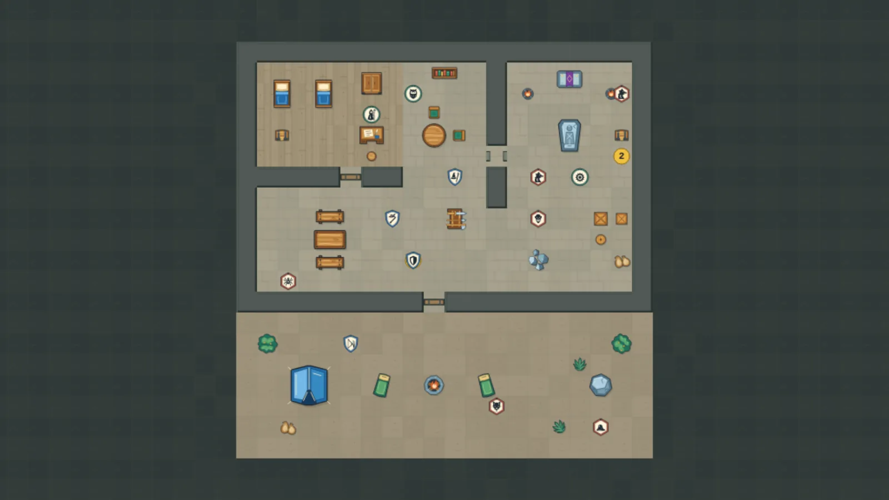
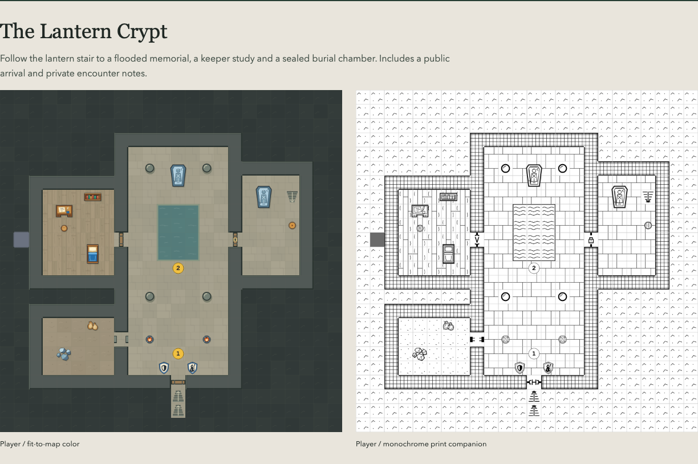

<p align="center">
  <picture>
    <source media="(prefers-color-scheme: dark)" srcset="docs/assets/brand/logo-dark.svg" />
    
  </picture>
</p>

<p align="center">
  <a href="https://evilolive.com/Dungeon-Mapper/"></a>
  <a href="https://github.com/evillollive/Dungeon-Mapper/actions/workflows/ci.yml"></a>
  <a href="LICENSE"></a>
  
</p>

<h3 align="center">Make the map tonight, and run it tomorrow.</h3>

Dungeon Mapper is a free map builder for tabletop RPGs that runs in your browser, no account needed and nothing to install. Draw or generate a map, hide what your players shouldn't see, and bring it to your table.

<p align="center"><a href="https://evilolive.com/Dungeon-Mapper/"><b>Open Dungeon Mapper</b></a></p>



## Why GMs use it

- **A first draft in minutes.** Start from a sample, one of four map generators, or a blank grid, then keep polishing with furniture, tokens, notes, themes, and art layers.
- **Prep and play stay separate.** Set up fog and private notes ahead of time, then run the session on its own save without touching the map you built.
- **A second screen for players.** Open the player display, reveal rooms as the party explores, and blank it with one click.
- **One map, many looks.** The same layout can be a dungeon, castle, starship, cyberpunk street, pirate ship, or desert ruin, plus a black and white version for printing.
- **Free, and yours.** There's no paid tier and no account. Maps are saved in your browser, it works offline, and you can export a backup file whenever you want another copy.

## How it works

1. **Build the map.** Start from a sample, a generator, or a blank grid, then paint rooms, place furniture and tokens, and add notes only you can see.
2. **Decide what players see.** Turn on fog and pick the starting area: hidden tokens and private notes stay on your side.
3. **Show it at the table.** Open the player display on a second screen, and reveal rooms as the party explores.

Export a private backup, an image for players, or print pages whenever you need them. The [feature reference](docs/FEATURES.md) covers every tool.

## Features

| Area | What's included |
| --- | --- |
| Map editing | Grids from 8×8 to 128×128, 20 tile types, custom themes and tiles, undo and redo, copy and paste, background image tracing, and multi-level maps linked by stairs. |
| Generators | Rooms and corridors, open terrain, caverns, and villages, with repeatable seeds, density controls, rivers, and room labels. |
| At the table | Prepare and Run modes, a read-only player display, fog, tokens, initiative, measuring shapes, line of sight, area markers, and session checkpoints. |
| Art and themes | 13 themes plus Dungeon Folio, black and white print versions, paper textures, hand-drawn rendering, lighting, stamps, and scene templates. |
| Saving and export | Automatic saving in the browser, JSON backups, PNG and SVG export, high-resolution print pages, and offline use as an installed app. |



## Good to know

- Maps live in this browser on this device. Export a backup (**Export > Back up project**) before clearing browser data or switching computers.
- Backups don't include session records. In Run, **Download session recovery** keeps a private copy of a session in progress.
- PNG, SVG, and print pages are for sharing and printing; only JSON backups can be imported again.
- To use it offline, open **Offline & updates** while online and wait for **App and built-in art cached.**
- Print at actual size (100%) on A4 or Letter.

## Run it locally

You need Node.js 20 or newer.

```bash
git clone https://github.com/evillollive/Dungeon-Mapper.git
cd Dungeon-Mapper
npm install
npm run dev       # open the local address Vite prints, usually http://localhost:5173
```

Other commands:

```bash
npm run build     # type-check and build for production
npm run preview   # preview the production build
npm run lint      # run ESLint
npm test          # run the unit tests once
```

Pull requests run the unit tests plus browser tests in Chromium, Firefox, and WebKit, and the app deploys only after those pass. The [development guide](docs/DEVELOPMENT.md) covers project structure and tests.

## Documentation

| Need | Start here |
| --- | --- |
| Every tool, explained | [Feature reference](docs/FEATURES.md) |
| How the code fits together | [Architecture](docs/ARCHITECTURE.md) |
| Setup, scripts, and tests | [Development guide](docs/DEVELOPMENT.md) |
| Where it's headed | [Roadmap](docs/ROADMAP.md) and [user experience roadmap](docs/USER-EXPERIENCE-ROADMAP.md) |
| What changed | [Changelog](CHANGELOG.md) |

## Contributing

Found a bug or have an idea for a tool? [Open an issue](https://github.com/evillollive/Dungeon-Mapper/issues), or read [CONTRIBUTING.md](CONTRIBUTING.md) before sending a pull request.

## License

AGPL-3.0 © Alex Perrault
